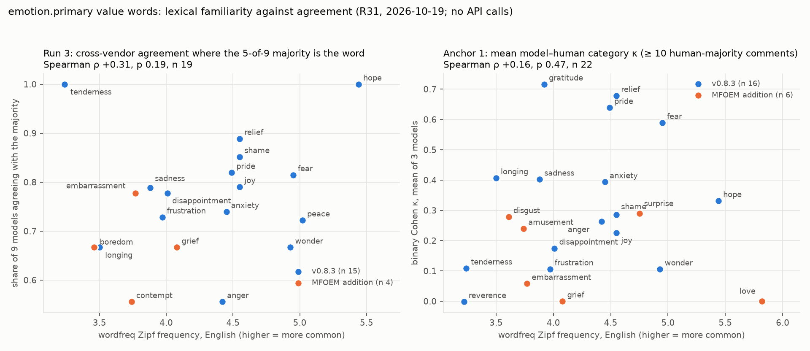

# Lexical familiarity of `emotion.primary` value words (R31)

Discovery output, 2026-10-19. Branch `discovery/ontology-crosswalk`. **Analysis only: no API call**; inputs are the existing run-3 and anchor-1 outputs (`experiments/2026-10-18-run3/`, `experiments/2026-10-18-anchor/`) and the run-1 outputs of the two run-1 voters that the 5-of-9 rule counts (`experiments/2026-10-17/raw/`). Script: `scripts/lexical_familiarity.py` (writes `lexical-familiarity.json`, `lexical-familiarity.png`, and the tables below). Ruling: `rulings-2026-10-18.md` R31. No schema file changed.

**Question.** Does how common a value word is in English predict how well extractors agree on it? If yes, the rarer MFOEM additions to the v0.9 recommended vocabulary would belong in a secondary tier; if no, familiarity is not a ground for tiering.

**Answer.** No detectable relation. Every Spearman test is weakly positive and none reaches p < 0.05: run-3 share of majority n 35, ρ +0.27, p 0.11; run-3 agreement rate n 19, ρ +0.31, p 0.19; anchor-1 mean model–human κ n 22, ρ +0.16, p 0.47. Within the 17 words the models were actually offered the picture is the same (n 17, ρ +0.26, p 0.32; n 15, ρ +0.17, p 0.54; n 16, ρ +0.20, p 0.46). The words that do agree badly (`reverence`, `tenderness`, `wonder`, `frustration`) sit at every frequency, and `gratitude`, the best-anchored word, is among the rarer ones.

## 1. Method

**Words (35).** The v0.8.3 canonical list for `constellation.emotion_primary` / v0.9 `emotion.primary` (17: `schema/fragments/constellation.json`, `x-edm-canonical`) and the 18 MFOEM emotion-process additions that `REPORT.md` §5 proposes as codes for the v0.9 recommended vocabulary: disgust, surprise, contempt, guilt, interest, awe, love, nostalgia, loneliness, grief, regret, embarrassment, envy, boredom, amusement, contentment, compassion, trust.

**Frequency.** `wordfreq` 3.1.1 (Robyn Speer; <https://github.com/rspeer/wordfreq>, Zenodo DOI 10.5281/zenodo.7199437), `zipf_frequency(word, 'en')` on the package's default English list (the combined 'large' list: Wikipedia, subtitles, news, books, web, Twitter/Reddit). The Zipf scale is log10 of occurrences per billion words; 3 ≈ one per million, 5 ≈ one per ten thousand. Rank 1 is the most frequent of the 35. Each value is a single token, so no lemmatisation is involved; the Zipf score is used directly in the correlation (Spearman is rank-based, so this equals the rank correlation with the sign referring to "more frequent").

**Run 3: per-value cross-vendor agreement.** The nine models of the 5-of-9 rule (`experiment-plan-run3.md`; R30): the six new run-3 arms (google/gemini-4-argon, deepseek/deepseek-v4-pro-0813, qwen/qwen3.8-2.4t-a95b, meta-llama/llama-4-maverick, mistralai/mistral-large-4-0, openai/gpt-oss-120b), Sonnet 5.5's run-3 re-run, and the run-1 voters gpt-6.1-sol and Kimi K2.6 on the same 150 texts (run-3 texts are the run-1 corpus by manifest). Haiku 5.5 is the cheap-tier reference, not one of the nine, and is not used. Per model and text the modal `emotion.primary` label over the valid repeats (labels lower-cased, whitespace and hyphens to underscores, empty / null / none → `null`; no collapse of free text). Modal ties by repeat order, counted (33 in all; DeepSeek 16, Mistral 11). A text has a **majority** value when ≥ 5 of the models with a label share the modal label: 116 of 150 texts; 13 of those have `null` as the majority and one has `irritation` (outside both lists). Per word: *share* = texts whose majority is the word / 150; *agreement rate* = mean over those texts of (models whose modal label is the word) / (models with a label). Sensitivity: plurality majority (largest unique count, no ≥ 5 floor; 140 texts) and the raw count of model-text modals carrying the word over all 9 × 150 cells.

**Anchor 1: per-value model–human κ.** 1,000 GoEmotions comments, three extractors (Claude Sonnet 5.5, Gemini 4 Argon, gpt-oss-120b), three repeats; per model the modal label per comment as above. Human side: the comment's GoEmotions majority label mapped through the frozen G2E mapping (`experiment-plan-anchor.md` §3; `score_anchor.py`). Cohen's κ restricted to the comments whose human majority is a given word is undefined (the human side is constant, so κ ≡ 0), so the per-value statistic is the standard **category-specific κ**: binary Cohen's κ for "label is the word" against "label is not the word" over all 1,000 comments, per model, then the mean of the three. Reported beside it: *recall*, the share of the word's human-majority comments where the model's modal label is the word. A word enters the correlation when ≥ 10 human-majority comments map to it. For the MFOEM additions that are themselves GoEmotions labels (love, surprise, embarrassment, grief, amusement, disgust; marked † in the table) the human side is the GoEmotions label taken directly, outside the frozen mapping; this is exploratory, and the models were never offered these words, so their κ measures prompt compliance as much as familiarity (see §3). `peace` has no GoEmotions source label and no anchor figure.

**Test.** Spearman's ρ (`scipy.stats.spearmanr`, two-sided p) between Zipf and each measure; n is the number of words with a value for that measure.

## 2. Results

| Word | Tier | Zipf | Rank | R3 majority n | R3 share | R3 agreement | R3 plurality n / agr | R3 model-text modals | A1 human n | A1 κ mean | A1 κ per model | A1 recall |
|---|---|---|---|---|---|---|---|---|---|---|---|---|
| love | MFOEM addition | 5.82 | 1 | 0 | 0.000 | — | 0 / — | 1 | 39 † | 0.00 | 0.00 / 0.00 / 0.00 | 0.00 |
| hope | v0.8.3 | 5.44 | 2 | 1 | 0.007 | 1.00 | 1 / 1.00 | 23 | 30 | 0.33 | 0.35 / 0.33 / 0.31 | 0.34 |
| interest | MFOEM addition | 5.17 | 3 | 0 | 0.000 | — | 0 / — | 8 | 0 | — | — | — |
| trust | MFOEM addition | 5.13 | 4 | 0 | 0.000 | — | 0 / — | 0 | 0 | — | — | — |
| peace | v0.8.3 | 5.02 | 5 | 4 | 0.027 | 0.72 | 5 / 0.67 | 45 | 0 | — | — | — |
| fear | v0.8.3 | 4.95 | 6 | 3 | 0.020 | 0.81 | 4 / 0.69 | 35 | 22 | 0.59 | 0.55 / 0.58 / 0.64 | 0.56 |
| wonder | v0.8.3 | 4.93 | 7 | 3 | 0.020 | 0.67 | 5 / 0.56 | 36 | 65 | 0.11 | 0.03 / 0.28 / 0.01 | 0.08 |
| surprise | MFOEM addition | 4.75 | 8 | 0 | 0.000 | — | 0 / — | 1 | 27 † | 0.29 | 0.46 / 0.00 / 0.41 | 0.23 |
| joy | v0.8.3 | 4.55 | 9 | 26 | 0.173 | 0.79 | 31 / 0.73 | 247 | 29 | 0.23 | 0.29 / 0.18 / 0.21 | 0.62 |
| shame | v0.8.3 | 4.55 | 10 | 3 | 0.020 | 0.85 | 4 / 0.75 | 35 | 39 | 0.28 | 0.20 / 0.42 / 0.23 | 0.21 |
| relief | v0.8.3 | 4.55 | 11 | 9 | 0.060 | 0.89 | 9 / 0.89 | 98 | 16 | 0.68 | 0.69 / 0.68 / 0.66 | 0.79 |
| pride | v0.8.3 | 4.49 | 12 | 8 | 0.053 | 0.82 | 8 / 0.82 | 81 | 16 | 0.64 | 0.66 / 0.50 / 0.76 | 0.69 |
| anxiety | v0.8.3 | 4.45 | 13 | 12 | 0.080 | 0.74 | 14 / 0.69 | 117 | 16 | 0.39 | 0.40 / 0.40 / 0.38 | 0.52 |
| anger | v0.8.3 | 4.42 | 14 | 2 | 0.013 | 0.56 | 2 / 0.56 | 14 | 32 | 0.26 | 0.31 / 0.25 / 0.22 | 0.39 |
| regret | MFOEM addition | 4.37 | 15 | 0 | 0.000 | — | 0 / — | 0 | 0 | — | — | — |
| guilt | MFOEM addition | 4.13 | 16 | 0 | 0.000 | — | 0 / — | 2 | 0 | — | — | — |
| grief | MFOEM addition | 4.08 | 17 | 1 | 0.007 | 0.67 | 1 / 0.67 | 10 | 16 † | 0.00 | 0.00 / 0.00 / 0.00 | 0.00 |
| disappointment | v0.8.3 | 4.01 | 18 | 6 | 0.040 | 0.78 | 7 / 0.73 | 63 | 26 | 0.17 | 0.14 / 0.22 / 0.16 | 0.29 |
| frustration | v0.8.3 | 3.97 | 19 | 9 | 0.060 | 0.73 | 15 / 0.61 | 119 | 38 | 0.11 | 0.10 / 0.09 / 0.13 | 0.23 |
| compassion | MFOEM addition | 3.95 | 20 | 0 | 0.000 | — | 0 / — | 0 | 0 | — | — | — |
| gratitude | v0.8.3 | 3.92 | 21 | 0 | 0.000 | — | 0 / — | 12 | 51 | 0.72 | 0.76 / 0.67 / 0.72 | 0.71 |
| sadness | v0.8.3 | 3.88 | 22 | 10 | 0.067 | 0.79 | 10 / 0.79 | 95 | 28 | 0.40 | 0.45 / 0.36 / 0.40 | 0.46 |
| envy | MFOEM addition | 3.84 | 23 | 0 | 0.000 | — | 0 / — | 0 | 0 | — | — | — |
| awe | MFOEM addition | 3.80 | 24 | 0 | 0.000 | — | 0 / — | 0 | 0 | — | — | — |
| embarrassment | MFOEM addition | 3.77 | 25 | 1 | 0.007 | 0.78 | 2 / 0.61 | 12 | 18 † | 0.06 | -0.00 / 0.00 / 0.18 | 0.04 |
| contempt | MFOEM addition | 3.74 | 26 | 1 | 0.007 | 0.56 | 1 / 0.56 | 5 | 0 | — | — | — |
| amusement | MFOEM addition | 3.74 | 27 | 0 | 0.000 | — | 0 / — | 1 | 42 † | 0.24 | 0.43 / 0.00 / 0.29 | 0.31 |
| loneliness | MFOEM addition | 3.65 | 28 | 0 | 0.000 | — | 0 / — | 1 | 0 | — | — | — |
| nostalgia | MFOEM addition | 3.62 | 29 | 0 | 0.000 | — | 0 / — | 0 | 0 | — | — | — |
| disgust | MFOEM addition | 3.61 | 30 | 0 | 0.000 | — | 0 / — | 0 | 23 † | 0.28 | 0.35 / 0.14 / 0.35 | 0.23 |
| longing | v0.8.3 | 3.50 | 31 | 1 | 0.007 | 0.67 | 1 / 0.67 | 7 | 21 | 0.41 | 0.42 / 0.49 / 0.31 | 0.33 |
| boredom | MFOEM addition | 3.46 | 32 | 1 | 0.007 | 0.67 | 1 / 0.67 | 6 | 0 | — | — | — |
| tenderness | v0.8.3 | 3.24 | 33 | 1 | 0.007 | 1.00 | 2 / 0.72 | 20 | 65 | 0.11 | 0.09 / 0.15 / 0.09 | 0.08 |
| reverence | v0.8.3 | 3.22 | 34 | 0 | 0.000 | — | 0 / — | 1 | 61 | -0.00 | -0.00 / -0.00 / 0.00 | 0.00 |
| contentment | MFOEM addition | 3.05 | 35 | 0 | 0.000 | — | 0 / — | 8 | 0 | — | — | — |

Columns: R3 majority n / share / agreement as defined above; R3 plurality n / agr is the plurality sensitivity; R3 model-text modals counts every (model, text) modal cell carrying the word (of 9 × 150 = 1,350); A1 human n is the number of comments whose human majority maps to the word († = GoEmotions label taken directly); A1 κ per model is Gemini / gpt-oss / Sonnet.

Spearman tests (Zipf against the measure):

| Test | n | ρ | p |
|---|---|---|---|
| run3_share_majority_all35 | 35 | 0.273 | 0.112 |
| run3_agreement_rate_words_with_majority | 19 | 0.314 | 0.191 |
| run3_agreement_rate_plurality | 19 | 0.331 | 0.167 |
| run3_model_text_modals_all35 | 35 | 0.321 | 0.060 |
| anchor_kappa_mean_n_ge_10 | 22 | 0.162 | 0.472 |
| anchor_kappa_mean_all_scored | 22 | 0.162 | 0.472 |
| anchor_recall_mean_n_ge_10 | 22 | 0.202 | 0.368 |
| v083_only_run3_share | 17 | 0.257 | 0.319 |
| v083_only_run3_agreement_rate | 15 | 0.172 | 0.539 |
| v083_only_anchor_kappa_n_ge_10 | 16 | 0.198 | 0.463 |

## 3. Reading

- **Frequency does not predict agreement.** The strongest coefficient is the raw count of model-text modals (n 35, ρ +0.32, p 0.06), and that one is driven by the prompt: the 17 offered words are both more often written and, on the whole, more common in English than the additions; within the 17 it falls away.
- **The additions cannot be ranked from these runs.** In run 3 and anchor 1 the extractors were given the v0.8.3 list and "free text accepted". The MFOEM additions therefore appear only when a model volunteers them (`grief`, `embarrassment`, `boredom`, `contempt` each reach a single run-3 majority; `love` never appears because the frozen anchor mapping and the prompt both fold it into `tenderness`). Their near-zero cells are a property of the prompt, not of the words.
- **Where agreement is low, the cause is a seam, not rarity.** `reverence` (κ 0.00), `tenderness` (0.11) and `wonder` (0.11) fail against humans because GoEmotions admiration / love / caring / surprise / curiosity are read as `joy` or `other` (anchor RESULTS §4); `frustration` (0.11) and `disappointment` (0.17) blur into `anger` / `sadness`. `gratitude` (Zipf 3.92, rank 21 of 35) is the best-anchored word (κ 0.72), `relief` and `pride` next; all three are mid-frequency.

**Implication for the v0.9 recommended vocabulary (one sentence).** Lexical familiarity gives no ground for pushing the MFOEM additions to a secondary tier, so they stay in the headline recommended list as `REPORT.md` §5 proposes, with the caveat that the only evidence that could rank them is a run that offers them in the prompt (run-4 candidate; not pre-registered here).

## 4. Limits

- Observational, post hoc, not pre-registered; ten tests reported, none corrected (none is near significance, so correction changes nothing).
- Run-3 per-word n is small (one to twenty-six majority texts per word; 19 words with any); the agreement rate for a word with one majority text is one number.
- The anchor κ for the † words and the run-3 figures for all additions are confounded with prompt membership (above). A clean test needs the additions in the offered list.
- Zipf scores are for the bare English word, not for its use as an emotion label; `interest`, `trust`, `love`, `hope`, `peace` and `wonder` are frequent largely in non-emotional senses, which the measure cannot separate and which, if anything, inflates the familiarity of the words that agree worst (`wonder`) and best (`hope`) alike.
